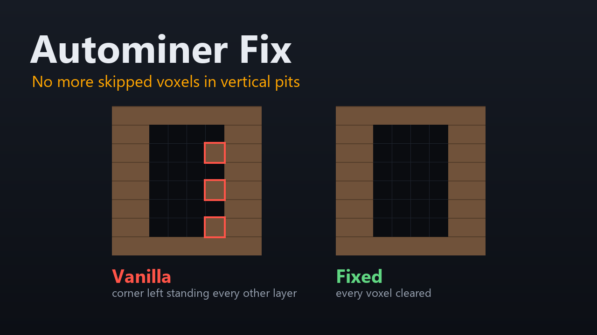

# Autominer Fix

A [StationeersLaunchPad](https://github.com/StationeersLaunchPad/StationeersLaunchPad) plugin
mod that fixes the base game's Autominer leaving voxels untouched when it digs a vertical pit.



## What was wrong

Two separate defects in `Assets.Scripts.Objects.Electrical.Quarry`, both in how the gantry
sweeps the pit. For the stock Autominer the pit is 4 voxels wide and 4 deep: the carriage has
three stops across and the two drill bits sit ±0.274 either side of it, so each stop clears two
columns and the stops together clear four. The gantry sweeps each layer in a serpentine, then
steps down.

### 1. The corner at each layer change is skipped

This is the alternating pattern: one voxel per layer, at the corner where the gantry descended,
alternating between the front and the rear of the shaft.

`RunDrillBit` decides when to mine and runs from `Update`, once per rendered frame. Movement
(`HandleMovement`) runs from `FixedUpdate`, 50 times a second. At the end of a layer the sweep
steps the target row out of the pit; the next frame's `HandleOutsideBounds` turns that back,
flips the row direction and lowers the head's target by one voxel. Vanilla only mines when the
carriage is at its target, and checks nothing about the head.

- If a `FixedUpdate` ran between those two frames, the carriage had begun moving towards the
  out-of-bounds row, so it is off its target and nothing happens until the head has descended
  and the carriage has come back. The corner is then mined at the new depth. This is the case
  the game was written against.
- If none did, the carriage never moved: it is exactly at its target while the head is still a
  voxel higher. The method moves the carriage's target one column along and calls
  `HandleMining`, which does nothing because the head hasn't moved. By the time the head has
  descended, the carriage has a new target, and the corner is never mined at the new depth.

So it is frame-rate dependent. At 50 frames per second or fewer there is a `FixedUpdate`
before every frame and it cannot happen. In the model a 60 fps run was clean and 144 and 240
fps lost a voxel on every layer; real frame pacing is uneven, so expect it to come and go
between those. Only the column of the corner that no other stop reaches is lost, so one voxel
per layer.

**Fix** ([QuarryRunDrillBitPatch.cs](Patches/QuarryRunDrillBitPatch.cs)): a transpiler adds
`&& DrillHead.localPosition == _drillEndSegmentY` to the arrival test, so the gantry waits for
the head to finish descending before it decides it has arrived.

### 2. The first row of a new pit is mined at one column only

The carriage starts at the +X edge of the pit, and the sweep direction starts as "+X". The
first step is out of bounds, `HandleOutsideBounds` pulls it back and moves to the next row, and
the rest of the first row of the first layer is never visited. Two voxels are left.

**Fix** ([QuarrySetupDrillHeadPatch.cs](Patches/QuarrySetupDrillHeadPatch.cs)): after
`SetupDrillHead`, start the sweep towards -X if the first +X step would leave the pit. Saves
restore the direction after that, so a half-dug pit carries on as before.

## How this was checked

The game's `Quarry` state machine (bounds, serpentine, `MoveTowards`, the arrival test, the
mining gate) was modelled in Python with the real prefab values (carriage and rail defaults,
`QuarryArea` 3.6 × 4.0, drill bits ±0.274, speed 1.3, 50 Hz fixed step), read from the game's
assets with UnityPy. Unpatched, that reproduces the report: complete layers at 60 fps or below,
and from 144 fps one voxel missing per layer alternating between the front and rear corner, plus
the two missing voxels in the first row of the first layer. Patched, every layer is 16/16 at
every frame rate tried.

The mod was then tested in the game with an Autominer (Small), at 117–205 fps: above the
50 fps threshold, so the layer-change bug could occur. Observed:

- No voxels left in the corners.
- Each descent dug out 1 m × 0.5 m.
- Unchanged behaviour elsewhere: it exposed lava on Vulcan, worked on Mimas, still caused the
  same chaotic airflow on Venus (the mining head changes the cell volume), and still gathered
  ores.
- It stopped after trying to descend into bedrock, and that attempt did not mine bedrock.

## Building

Needs the .NET SDK and a Stationeers install.

```
dotnet build Main.csproj
dotnet build Main.csproj -t:Install
```

The second form copies the plugin and `About/` into LaunchPad's local mods folder. Set the game
path in a gitignored `Local.Developer.props` if it isn't found automatically. See
[AGENTS.md](AGENTS.md) for the repo's quirks (versioning, local paths, CI).

`About/Preview.png` and `About/thumb.png` come from `python tools/make_images.py` (Pillow).

## Compatibility

Patches `Quarry.RunDrillBit` (transpiler) and `Quarry.SetupDrillHead` (postfix). If a game
update changes the shape of `RunDrillBit`, the transpiler logs a warning and leaves vanilla
behaviour in place instead of guessing. Other mods that patch the same methods may conflict.
